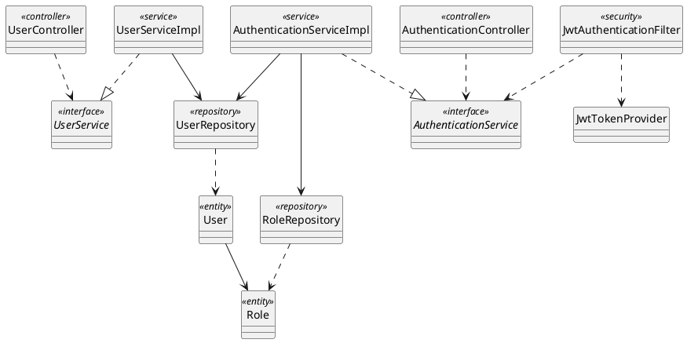
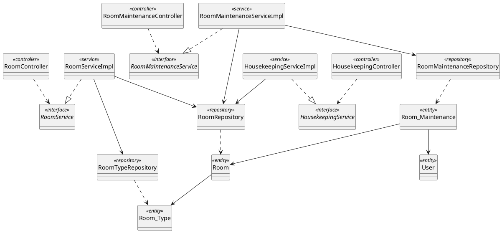
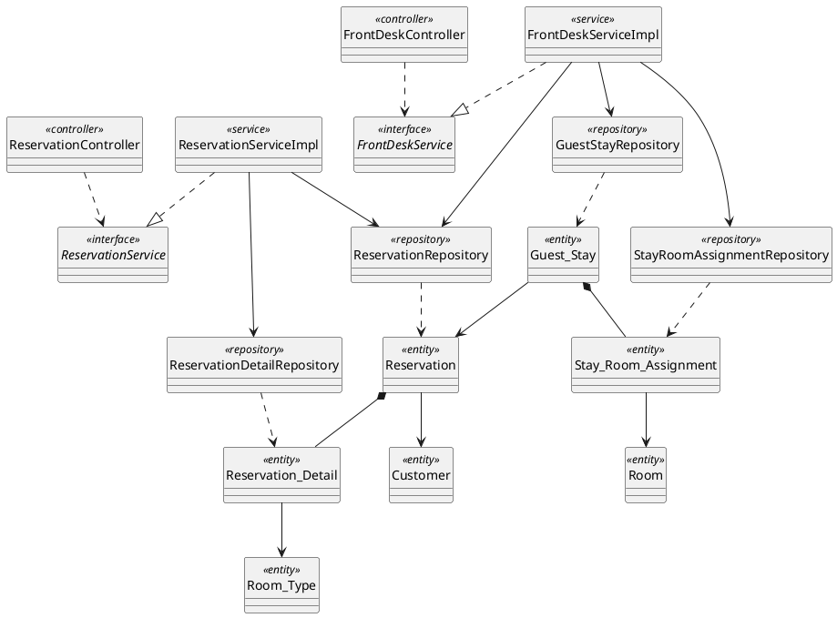
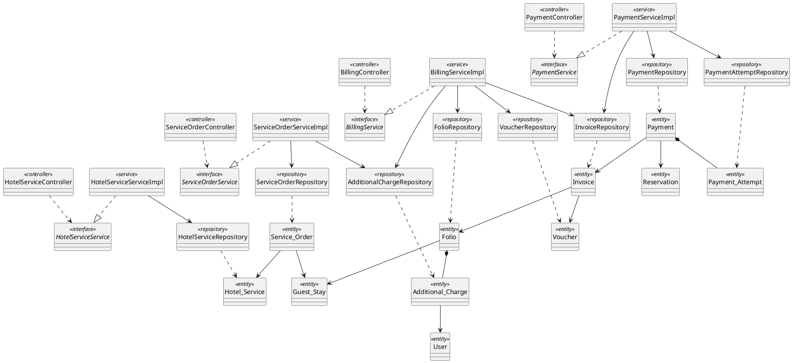
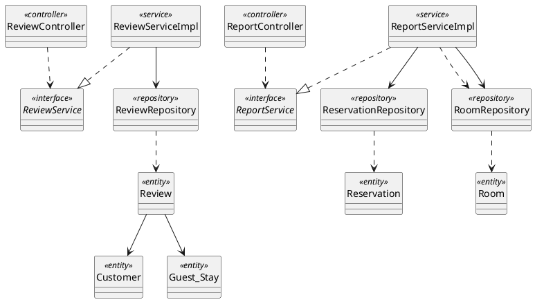

# Backend Class/Component Structure Design (PlantUML)

Tài liệu thiết kế cấu trúc thành phần tầng Backend cho toàn bộ 5 phân hệ của hệ thống Hotel Management System (HMS).
Được thiết kế chuẩn theo 6 loại quan hệ UML trong SKILL.md và đồng nhất 100% với CSDL quan hệ trong Section 5:
- **Inheritance (`--|>`):** Kế thừa lớp cha / repository base.
- **Realization (`..|>`):** ServiceImpl hiện thực hóa Service interface.
- **Dependency (`..>`):** Controller sử dụng Service, Repository trả về Entity.
- **Association (`-->`):** Liên kết có hướng chuẩn mực (Service giữ tham chiếu điều hướng Repository thông qua Dependency Injection; Entity tham chiếu Entity khác thông qua khóa ngoại, ví dụ `User --> Role`, `Room --> Room_Type`, `Review --> Guest_Stay`, `Invoice --> Voucher`, `Payment --> Reservation`).
- **Composition (`*--`):** Has-a chặt chẽ phụ thuộc vòng đời (Reservation sở hữu Reservation_Detail, Guest_Stay sở hữu Stay_Room_Assignment, Folio sở hữu Additional_Charge, Payment sở hữu Payment_Attempt).
- **Aggregation (`o--`):** Has-a sở hữu lỏng lẻo toàn thể - bộ phận (Whole-Part độc lập).

---

## 1. Mục 4.2: Account & Authentication Management

---

## 2. Mục 4.3: Room & Facility Management (Housekeeping & Maintenance)

---

## 3. Mục 4.4: Reservation & Front-Desk Operations

---

## 4. Mục 4.5: Ancillary Services & Billing Management

---

## 5. Mục 4.6: Reviews, Audit & Reporting Management

