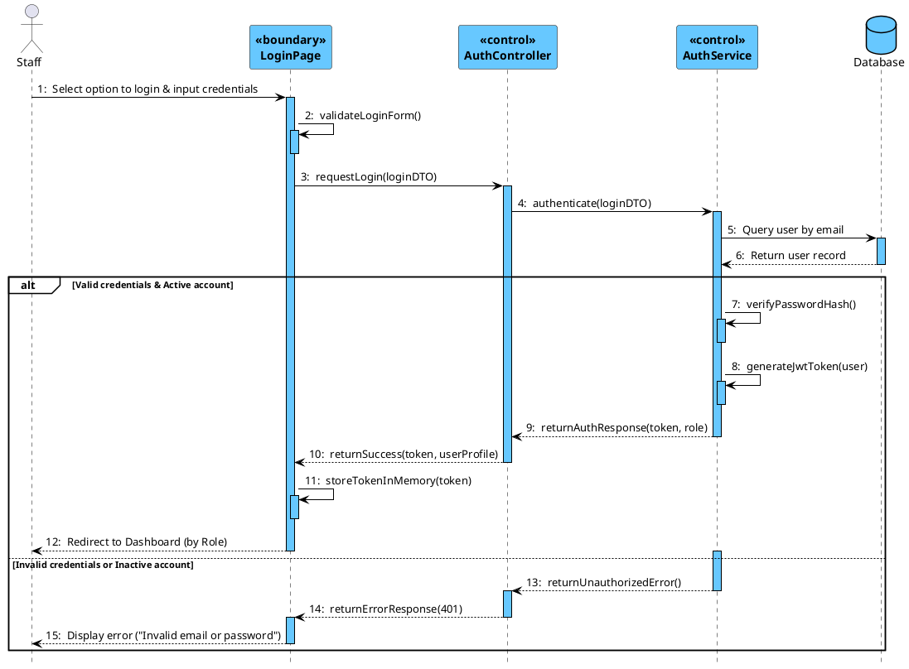
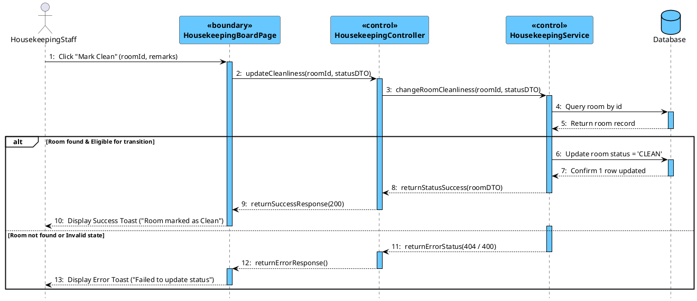
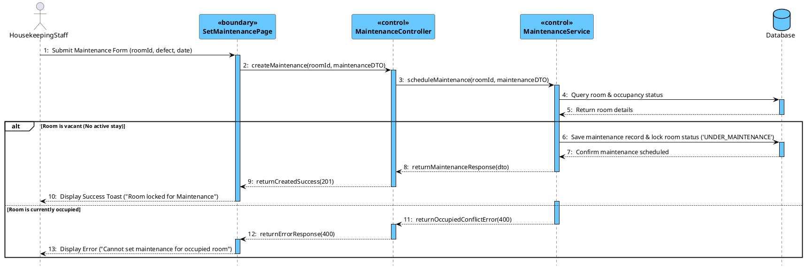
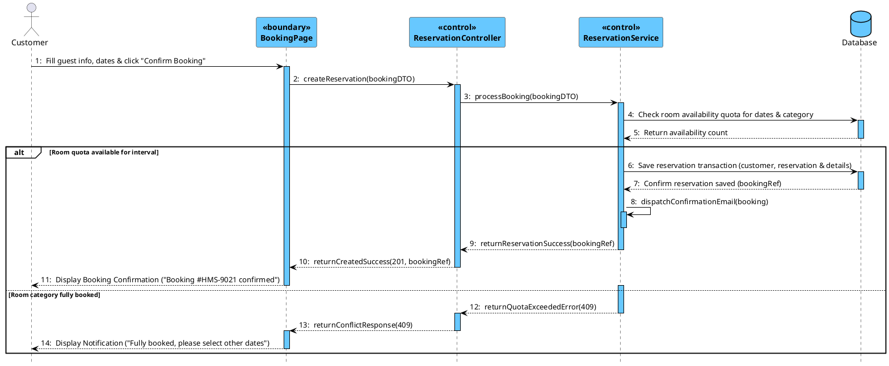
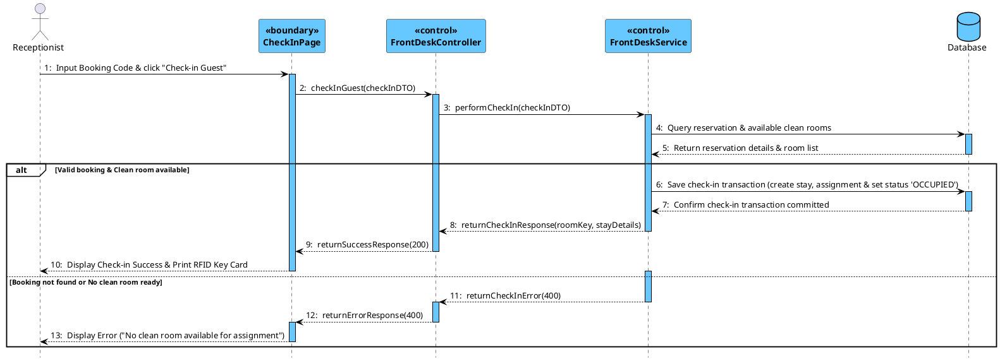
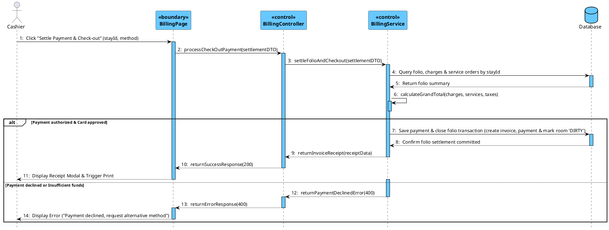
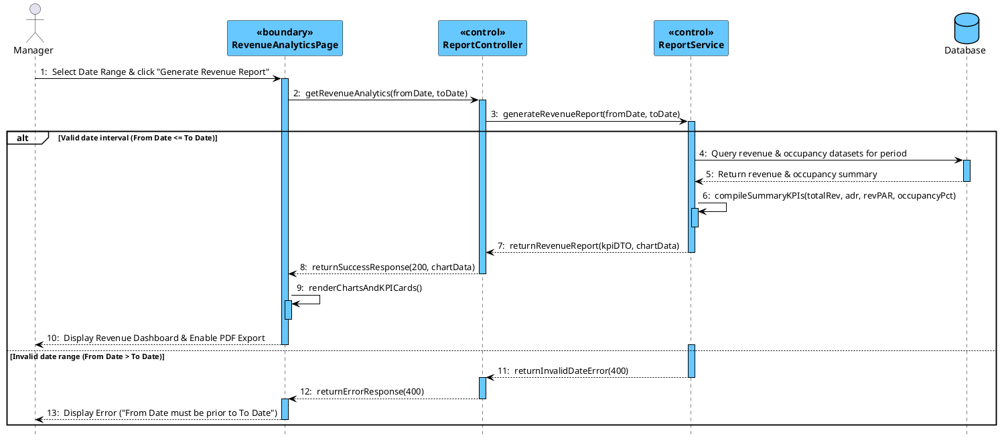

# Sequence Diagram(s) (PlantUML)

Tài liệu thiết kế Sơ đồ tương tác đối tượng (Sequence Diagrams) cho các Use Case cốt lõi thuộc 5 phân hệ của hệ thống HMS.
Thiết kế chuẩn phương pháp COMET & Visual Paradigm: Áp dụng đầy đủ stereotype `<<boundary>>` cho các trang giao diện, `<<control>>` cho Controller và Service, và `Database` cho tầng CSDL. Sử dụng phong cách thẩm mỹ Visual Paradigm với màu xanh Cyan #67C8FF, các khung `alt` điều kiện tiếng Anh in đậm màu đen, thể hiện luồng trao đổi thông điệp hoàn chỉnh từ Actor -> Boundary -> Control -> Database.

---

## 1. Mục 4.2: UC-02 User Login Flow

**Table 4-3: Interaction Steps for UC-02 User Login Flow**

| Step | Caller (From) | Callee (To) | Action / Method | Description |
| :---: | :--- | :--- | :--- | :--- |
| 1 | Staff | LoginPage | `Select option to login & input credentials` | Staff accesses login screen and enters email and password. |
| 2 | LoginPage | LoginPage | `validateLoginForm()` | Validates client-side input for non-empty fields and valid email format. |
| 3 | LoginPage | AuthController | `requestLogin(loginDTO)` | Dispatches HTTP POST request with authentication credentials payload. |
| 4 | AuthController | AuthService | `authenticate(loginDTO)` | Delegates credential authentication logic to security service layer. |
| 5 | AuthService | Database | `Query user by email` | Retrieves active user account entity by unique email address. |
| 6 | Database | AuthService | `Return user record` | Returns user record with encrypted password hash and assigned role. |
| 7 [Success] | AuthService | AuthService | `verifyPasswordHash()` | Verifies submitted password against stored BCrypt hash. |
| 8 [Success] | AuthService | AuthService | `generateJwtToken(user)` | Signs and generates JWT token containing user identity and role claims. |
| 9 [Success] | AuthService | AuthController | `returnAuthResponse(token, role)` | Returns authentication response DTO with generated JWT token. |
| 10 [Success] | AuthController | LoginPage | `returnSuccess(token, userProfile)` | Responds with HTTP 200 OK and authenticated user profile payload. |
| 11 [Success] | LoginPage | LoginPage | `storeTokenInMemory(token)` | Saves JWT token in client state/memory for subsequent API calls. |
| 12 [Success] | LoginPage | Staff | `Redirect to Dashboard (by Role)` | Redirects user to the designated portal based on their assigned role. |
| 13 [Failure] | AuthService | AuthController | `returnUnauthorizedError()` | Throws BadCredentialsException when email/password is invalid or inactive. |
| 14 [Failure] | AuthController | LoginPage | `returnErrorResponse(401)` | Responds with HTTP 401 Unauthorized status and error code. |
| 15 [Failure] | LoginPage | Staff | `Display error ("Invalid email or password")` | Displays localized error toast notification on login form. |

---

## 2. Mục 4.3: Room & Facility Management

### 2.1 UC-19 Update Housekeeping Status

**Table 4-6: Interaction Steps for UC-19 Update Housekeeping Status**

| Step | Caller (From) | Callee (To) | Action / Method | Description |
| :---: | :--- | :--- | :--- | :--- |
| 1 | HousekeepingStaff | HousekeepingBoardPage | `Click "Mark Clean" (roomId, remarks)` | Staff selects room on housekeeping board and submits cleanliness update. |
| 2 | HousekeepingBoardPage | HousekeepingController | `updateCleanliness(roomId, statusDTO)` | Dispatches HTTP PUT request with target status and remarks. |
| 3 | HousekeepingController | HousekeepingService | `changeRoomCleanliness(roomId, statusDTO)` | Delegates room cleanliness state transition to housekeeping service. |
| 4 | HousekeepingService | Database | `Query room by id` | Retrieves physical room entity and validates current status. |
| 5 | Database | HousekeepingService | `Return room record` | Returns room entity with current status and room category. |
| 6 [Success] | HousekeepingService | Database | `Update room status = 'CLEAN'` | Updates room status to CLEAN and logs cleaning timestamp. |
| 7 [Success] | Database | HousekeepingService | `Confirm 1 row updated` | Database confirms successful record update. |
| 8 [Success] | HousekeepingService | HousekeepingController | `returnStatusSuccess(roomDTO)` | Returns updated room state DTO. |
| 9 [Success] | HousekeepingController | HousekeepingBoardPage | `returnSuccessResponse(200)` | Responds with HTTP 200 OK status. |
| 10 [Success] | HousekeepingBoardPage | HousekeepingStaff | `Display Success Toast ("Room marked as Clean")` | Displays success toast notification and updates room badge to Clean. |
| 11 [Failure] | HousekeepingService | HousekeepingController | `returnErrorStatus(404 / 400)` | Returns error when room is not found or status transition is invalid. |
| 12 [Failure] | HousekeepingController | HousekeepingBoardPage | `returnErrorResponse()` | Responds with HTTP 400/404 error response. |
| 13 [Failure] | HousekeepingBoardPage | HousekeepingStaff | `Display Error Toast ("Failed to update status")` | Renders error toast notification on housekeeping board. |

---

### 2.2 UC-20 Set Room Maintenance

**Table 4-7: Interaction Steps for UC-20 Set Room Maintenance**

| Step | Caller (From) | Callee (To) | Action / Method | Description |
| :---: | :--- | :--- | :--- | :--- |
| 1 | HousekeepingStaff | SetMaintenancePage | `Submit Maintenance Form (roomId, defect, date)` | Staff submits maintenance form with defect reason and expected completion. |
| 2 | SetMaintenancePage | MaintenanceController | `createMaintenance(roomId, maintenanceDTO)` | Dispatches HTTP POST request to schedule maintenance ticket. |
| 3 | MaintenanceController | MaintenanceService | `scheduleMaintenance(roomId, maintenanceDTO)` | Delegates maintenance scheduling logic to maintenance service layer. |
| 4 | MaintenanceService | Database | `Query room & occupancy status` | Checks room occupancy to ensure no active guest stay is present. |
| 5 | Database | MaintenanceService | `Return room details` | Returns room record with current status and stay assignments. |
| 6 [Success] | MaintenanceService | Database | `Save maintenance record & lock room status ('UNDER_MAINTENANCE')` | Atomically inserts maintenance order and updates room status to UNDER_MAINTENANCE. |
| 7 [Success] | Database | MaintenanceService | `Confirm maintenance scheduled` | Database confirms maintenance transaction committed. |
| 8 [Success] | MaintenanceService | MaintenanceController | `returnMaintenanceResponse(dto)` | Returns maintenance ticket response DTO. |
| 9 [Success] | MaintenanceController | SetMaintenancePage | `returnCreatedSuccess(201)` | Responds with HTTP 201 Created status. |
| 10 [Success] | SetMaintenancePage | HousekeepingStaff | `Display Success Toast ("Room locked for Maintenance")` | Closes modal and updates room card status to Under Maintenance. |
| 11 [Failure] | MaintenanceService | MaintenanceController | `returnOccupiedConflictError(400)` | Returns conflict error when room is currently occupied by guests. |
| 12 [Failure] | MaintenanceController | SetMaintenancePage | `returnErrorResponse(400)` | Responds with HTTP 400 Bad Request error. |
| 13 [Failure] | SetMaintenancePage | HousekeepingStaff | `Display Error ("Cannot set maintenance for occupied room")` | Displays validation error prohibiting maintenance lock on occupied room. |

---

## 3. Mục 4.4: Reservation & Front-Desk Operations

### 3.1 UC-23 Room Reservation

**Table 4-9: Interaction Steps for UC-23 Room Reservation**

| Step | Caller (From) | Callee (To) | Action / Method | Description |
| :---: | :--- | :--- | :--- | :--- |
| 1 | Customer | BookingPage | `Fill guest info, dates & click "Confirm Booking"` | Guest fills contact details, check-in/out dates, and chooses room category. |
| 2 | BookingPage | ReservationController | `createReservation(bookingDTO)` | Dispatches HTTP POST request with reservation payload. |
| 3 | ReservationController | ReservationService | `processBooking(bookingDTO)` | Delegates booking business rules and allocation to reservation service. |
| 4 | ReservationService | Database | `Check room availability quota for dates & category` | Queries inventory count to verify capacity for requested interval. |
| 5 | Database | ReservationService | `Return availability count` | Returns remaining vacant room count for category. |
| 6 [Success] | ReservationService | Database | `Save reservation transaction (customer, reservation & details)` | Atomically creates customer profile, reservation header, and room detail rows. |
| 7 [Success] | Database | ReservationService | `Confirm reservation saved (bookingRef)` | Database confirms booking transaction and returns reference code. |
| 8 [Success] | ReservationService | ReservationService | `dispatchConfirmationEmail(booking)` | Asynchronously triggers booking confirmation email to customer. |
| 9 [Success] | ReservationService | ReservationController | `returnReservationSuccess(bookingRef)` | Returns reservation confirmation response DTO. |
| 10 [Success] | ReservationController | BookingPage | `returnCreatedSuccess(201, bookingRef)` | Responds with HTTP 201 Created and booking reference. |
| 11 [Success] | BookingPage | Customer | `Display Booking Confirmation ("Booking #HMS-9021 confirmed")` | Renders booking confirmation screen with code and instructions. |
| 12 [Failure] | ReservationService | ReservationController | `returnQuotaExceededError(409)` | Returns inventory conflict error when requested room type is fully booked. |
| 13 [Failure] | ReservationController | BookingPage | `returnConflictResponse(409)` | Responds with HTTP 409 Conflict status. |
| 14 [Failure] | BookingPage | Customer | `Display Notification ("Fully booked, please select other dates")` | Displays alert requesting customer to choose alternative dates or categories. |

---

### 3.2 UC-27 Guest Check-in

**Table 4-10: Interaction Steps for UC-27 Guest Check-in**

| Step | Caller (From) | Callee (To) | Action / Method | Description |
| :---: | :--- | :--- | :--- | :--- |
| 1 | Receptionist | CheckInPage | `Input Booking Code & click "Check-in Guest"` | Front-desk receptionist enters booking code and initiates check-in. |
| 2 | CheckInPage | FrontDeskController | `checkInGuest(checkInDTO)` | Dispatches HTTP POST request with check-in payload. |
| 3 | FrontDeskController | FrontDeskService | `performCheckIn(checkInDTO)` | Transfers check-in workflow to front-desk service layer. |
| 4 | FrontDeskService | Database | `Query reservation & available clean rooms` | Verifies booking status and searches for available CLEAN rooms of category. |
| 5 | Database | FrontDeskService | `Return reservation details & room list` | Returns verified reservation details and eligible room candidates. |
| 6 [Success] | FrontDeskService | Database | `Save check-in transaction (create stay, assignment & set status 'OCCUPIED')` | Atomically creates guest stay, assigns physical room, and marks room OCCUPIED. |
| 7 [Success] | Database | FrontDeskService | `Confirm check-in transaction committed` | Database confirms transaction committed successfully. |
| 8 [Success] | FrontDeskService | FrontDeskController | `returnCheckInResponse(roomKey, stayDetails)` | Returns check-in summary DTO with RFID room key payload. |
| 9 [Success] | FrontDeskController | CheckInPage | `returnSuccessResponse(200)` | Responds with HTTP 200 OK status. |
| 10 [Success] | CheckInPage | Receptionist | `Display Check-in Success & Print RFID Key Card` | Renders check-in success badge and triggers RFID key encoder. |
| 11 [Failure] | FrontDeskService | FrontDeskController | `returnCheckInError(400)` | Returns error if booking is not found or no clean room is available. |
| 12 [Failure] | FrontDeskController | CheckInPage | `returnErrorResponse(400)` | Responds with HTTP 400 Bad Request error. |
| 13 [Failure] | CheckInPage | Receptionist | `Display Error ("No clean room available for assignment")` | Displays descriptive error alert banner on check-in interface. |

---

## 4. Mục 4.5: UC-37 & UC-39 Check-out & Payment Settlement

**Table 4-12: Interaction Steps for UC-37 & UC-39 Check-out & Payment Settlement**

| Step | Caller (From) | Callee (To) | Action / Method | Description |
| :---: | :--- | :--- | :--- | :--- |
| 1 | Cashier | BillingPage | `Click "Settle Payment & Check-out" (stayId, method)` | Cashier verifies folio charges and initiates final payment settlement. |
| 2 | BillingPage | BillingController | `processCheckOutPayment(settlementDTO)` | Dispatches HTTP POST request with settlement parameters. |
| 3 | BillingController | BillingService | `settleFolioAndCheckout(settlementDTO)` | Delegates folio closing and payment settlement to billing service. |
| 4 | BillingService | Database | `Query folio, charges & service orders by stayId` | Loads folio line items, room charges, and consumed service orders. |
| 5 | Database | BillingService | `Return folio summary` | Returns itemized consumption records and preliminary balance. |
| 6 | BillingService | BillingService | `calculateGrandTotal(charges, services, taxes)` | Calculates net subtotal, applicable taxes (VAT), discounts, and total due. |
| 7 [Success] | BillingService | Database | `Save payment & close folio transaction (create invoice, payment & mark room 'DIRTY')` | Atomically creates fiscal invoice, records payment, closes folio, and sets room DIRTY. |
| 8 [Success] | Database | BillingService | `Confirm folio settlement committed` | Database confirms payment and folio transaction committed. |
| 9 [Success] | BillingService | BillingController | `returnInvoiceReceipt(receiptData)` | Returns itemized invoice receipt DTO. |
| 10 [Success] | BillingController | BillingPage | `returnSuccessResponse(200)` | Responds with HTTP 200 OK status. |
| 11 [Success] | BillingPage | Cashier | `Display Receipt Modal & Trigger Print` | Displays receipt modal with invoice breakdown and triggers print dialog. |
| 12 [Failure] | BillingService | BillingController | `returnPaymentDeclinedError(400)` | Returns payment gateway rejection or insufficient funds error. |
| 13 [Failure] | BillingController | BillingPage | `returnErrorResponse(400)` | Responds with HTTP 400 Bad Request error. |
| 14 [Failure] | BillingPage | Cashier | `Display Error ("Payment declined, request alternative method")` | Displays payment failure notification requesting alternative payment. |

---

## 5. Mục 4.6: UC-46 Generate Revenue Analytics Report

**Table 4-14: Interaction Steps for UC-46 Generate Revenue Analytics Report**

| Step | Caller (From) | Callee (To) | Action / Method | Description |
| :---: | :--- | :--- | :--- | :--- |
| 1 | Manager | RevenueAnalyticsPage | `Select Date Range & click "Generate Revenue Report"` | Hotel Manager selects date interval and requests revenue report. |
| 2 | RevenueAnalyticsPage | ReportController | `getRevenueAnalytics(fromDate, toDate)` | Dispatches HTTP GET request with date filter query parameters. |
| 3 | ReportController | ReportService | `generateRevenueReport(fromDate, toDate)` | Delegates analytical reporting calculations to reporting service. |
| 4 [Success] | ReportService | Database | `Query revenue & occupancy datasets for period` | Queries invoices, room revenue, and daily occupied room inventory. |
| 5 [Success] | Database | ReportService | `Return revenue & occupancy summary` | Returns aggregate metrics dataset for requested period. |
| 6 [Success] | ReportService | ReportService | `compileSummaryKPIs(totalRev, adr, revPAR, occupancyPct)` | Calculates key KPIs: Total Revenue, ADR, RevPAR, and Occupancy Rate. |
| 7 [Success] | ReportService | ReportController | `returnRevenueReport(kpiDTO, chartData)` | Returns compiled report DTO with time-series chart data. |
| 8 [Success] | ReportController | RevenueAnalyticsPage | `returnSuccessResponse(200, chartData)` | Responds with HTTP 200 OK and chart dataset. |
| 9 [Success] | RevenueAnalyticsPage | RevenueAnalyticsPage | `renderChartsAndKPICards()` | Renders revenue trend line charts and summary KPI cards. |
| 10 [Success] | RevenueAnalyticsPage | Manager | `Display Revenue Dashboard & Enable PDF Export` | Displays analytics dashboard and activates PDF/Excel export buttons. |
| 11 [Failure] | ReportService | ReportController | `returnInvalidDateError(400)` | Returns date validation error when From Date is after To Date. |
| 12 [Failure] | ReportController | RevenueAnalyticsPage | `returnErrorResponse(400)` | Responds with HTTP 400 Bad Request error. |
| 13 [Failure] | RevenueAnalyticsPage | Manager | `Display Error ("From Date must be prior to To Date")` | Displays date range error toast message to Manager. |

