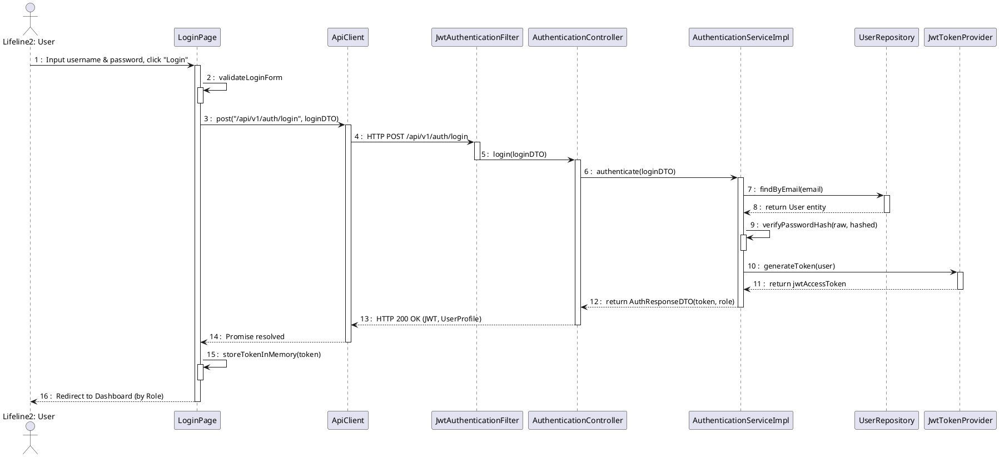
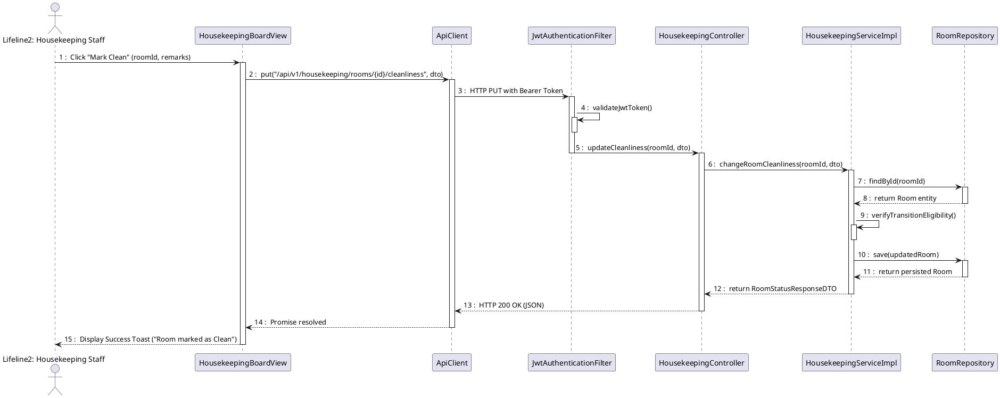
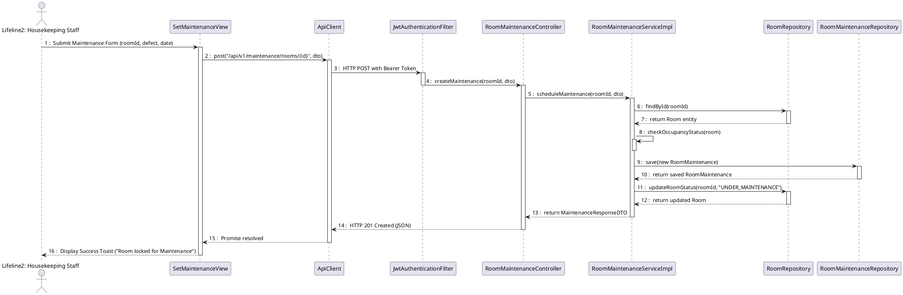
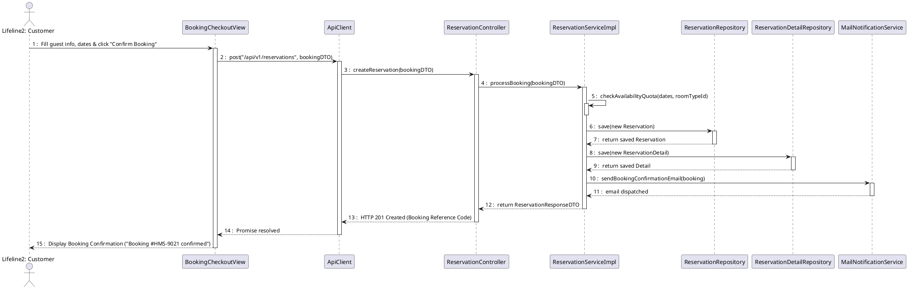
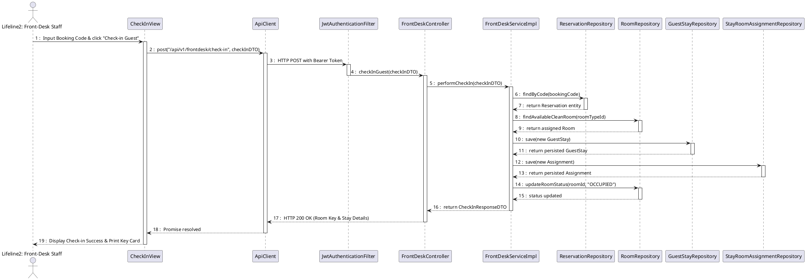
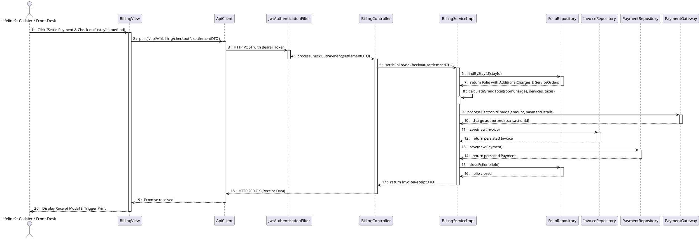
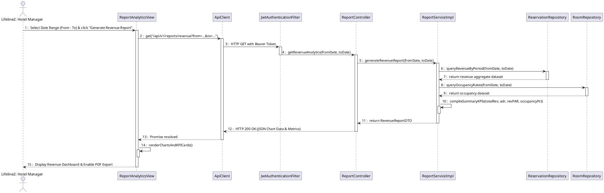

# Sequence Diagram(s) (PlantUML)

Tài liệu thiết kế Sơ đồ tương tác đối tượng (Sequence Diagrams) cho các Use Case cốt lõi thuộc 5 phân hệ của hệ thống HMS.
Tuân thủ tiêu chuẩn: Đánh số `autonumber 1 "0 : "`, Actor dạng người, tất cả các thành phần hệ thống đều dùng `participant` hình hộp chữ nhật, thể hiện đầy đủ self-call, activation bar và mũi tên nét đứt (`-->`) phản hồi.

---

## 1. Mục 4.2: UC-02 User Login Flow

---

## 2. Mục 4.3: Room & Facility Management

### 2.1 UC-19 Update Housekeeping Status

### 2.2 UC-20 Set Room Maintenance

---

## 3. Mục 4.4: Reservation & Front-Desk Operations

### 3.1 UC-21 & UC-23 Search & Create Room Reservation

### 3.2 UC-27 Check-in Guest

---

## 4. Mục 4.5: UC-37 & UC-39 Check-out & Payment Settlement

---

## 5. Mục 4.6: UC-46 Generate Revenue Analytics Report

