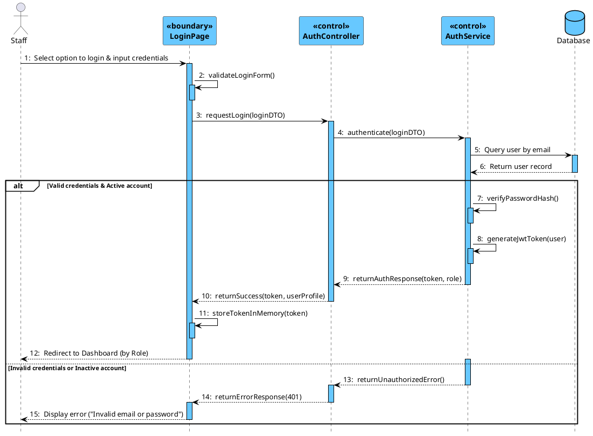
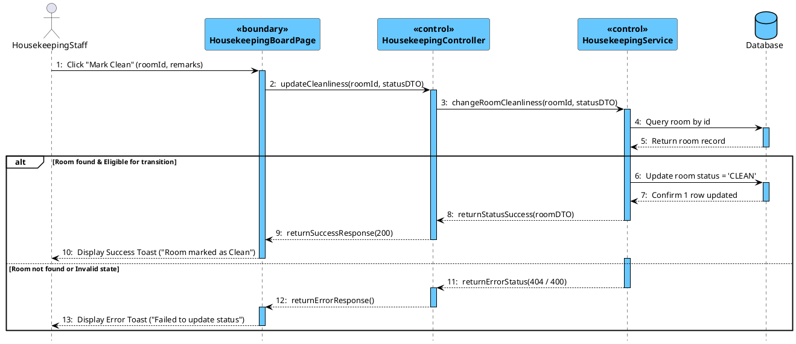
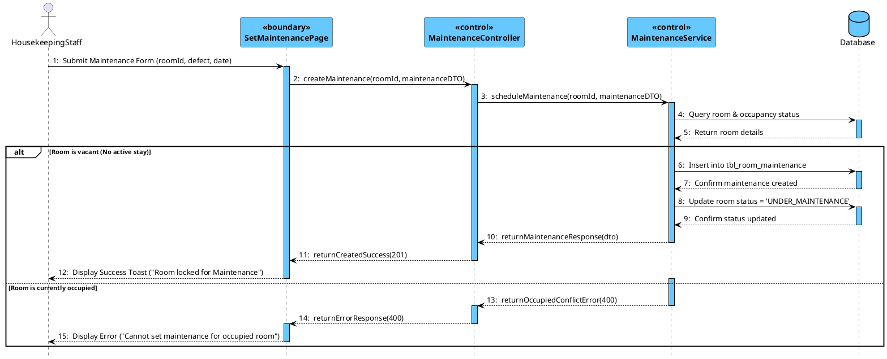
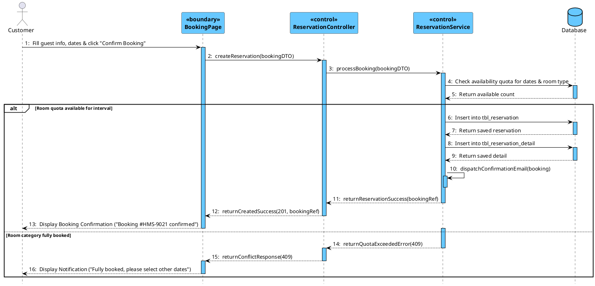
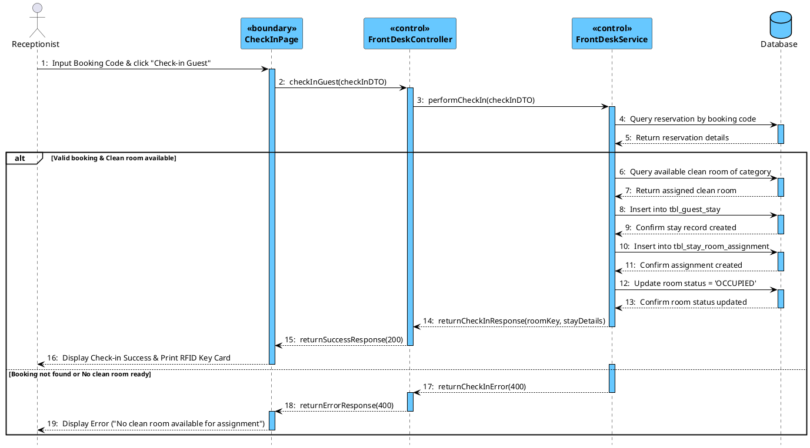
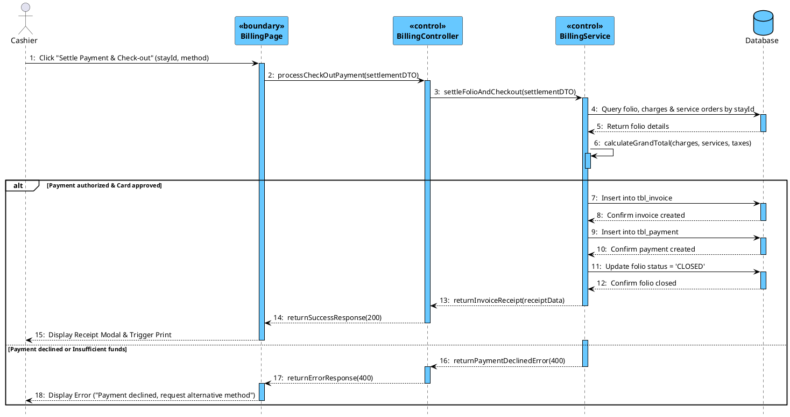
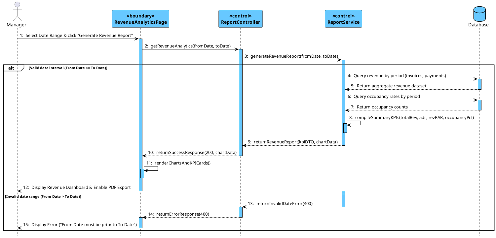

# Sequence Diagram(s) (PlantUML)

Tài liệu thiết kế Sơ đồ tương tác đối tượng (Sequence Diagrams) cho các Use Case cốt lõi thuộc 5 phân hệ của hệ thống HMS.
Thiết kế chuẩn phương pháp COMET & Visual Paradigm: Áp dụng đầy đủ stereotype `<<boundary>>` cho các trang giao diện, `<<control>>` cho Controller và Service, và `Database` cho tầng CSDL. Sử dụng phong cách thẩm mỹ Visual Paradigm với màu xanh Cyan #67C8FF, các khung `alt` điều kiện tiếng Anh in đậm màu đen, thể hiện luồng trao đổi thông điệp hoàn chỉnh từ Actor -> Boundary -> Control -> Database.

---

## 1. Mục 4.2: UC-02 User Login Flow

---

## 2. Mục 4.3: Room & Facility Management

### 2.1 UC-19 Update Housekeeping Status

---

### 2.2 UC-20 Set Room Maintenance

---

## 3. Mục 4.4: Reservation & Front-Desk Operations

### 3.1 UC-23 Room Reservation

---

### 3.2 UC-27 Guest Check-in

---

## 4. Mục 4.5: UC-37 & UC-39 Check-out & Payment Settlement

---

## 5. Mục 4.6: UC-46 Generate Revenue Analytics Report

---
